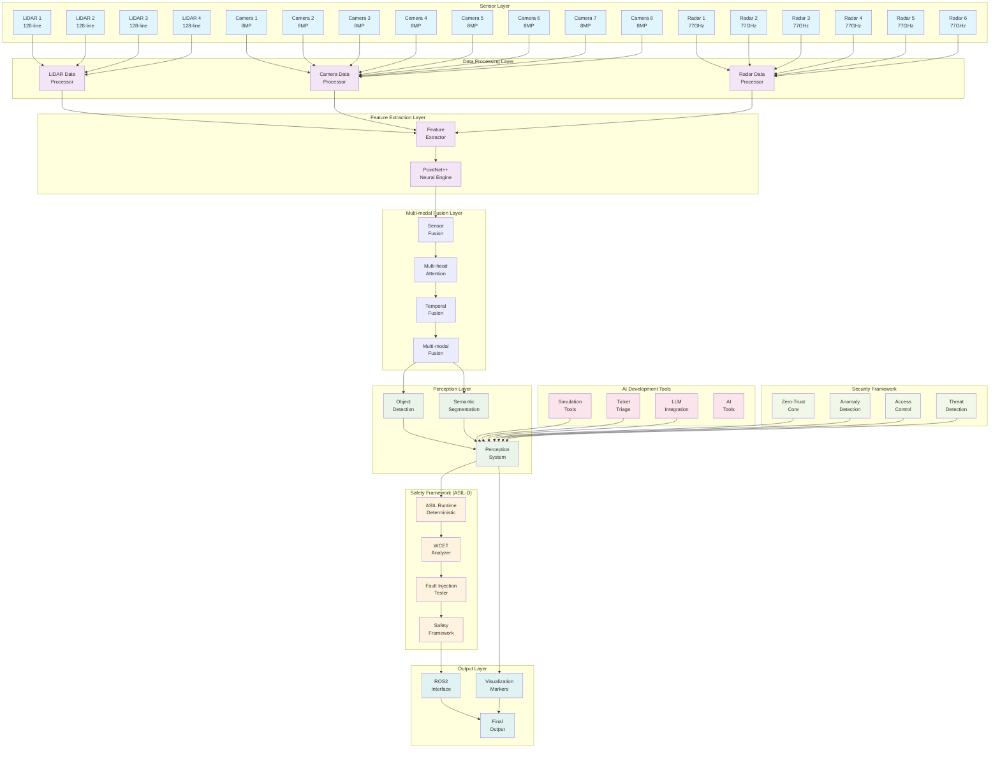
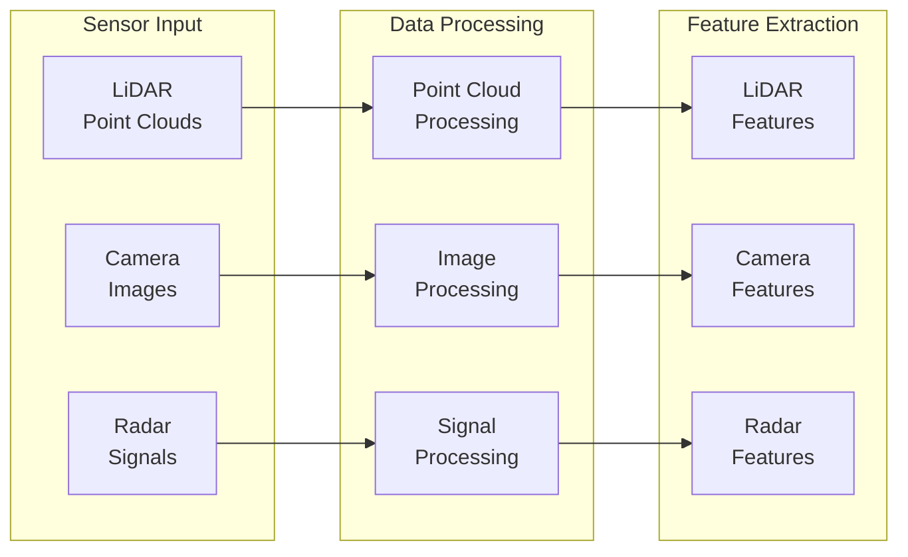
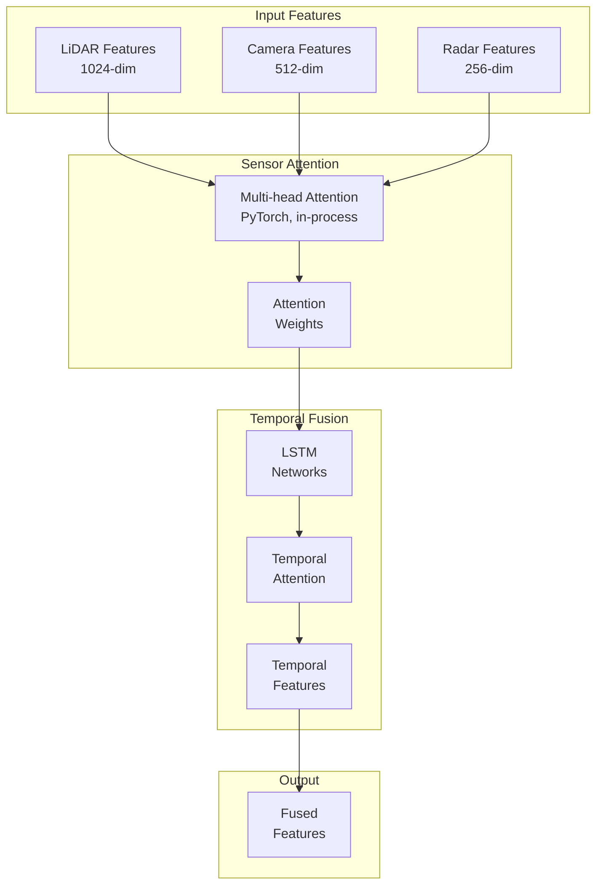
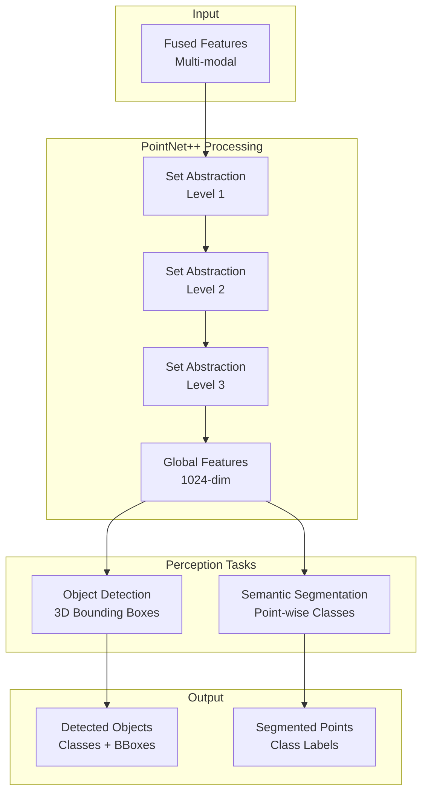
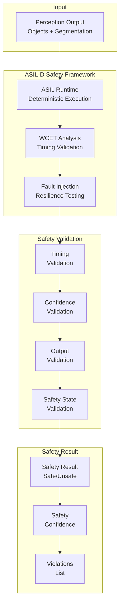
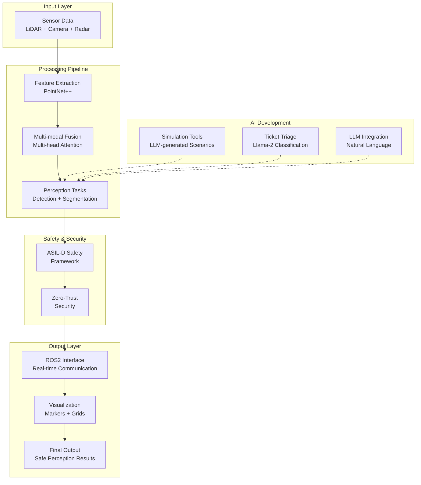
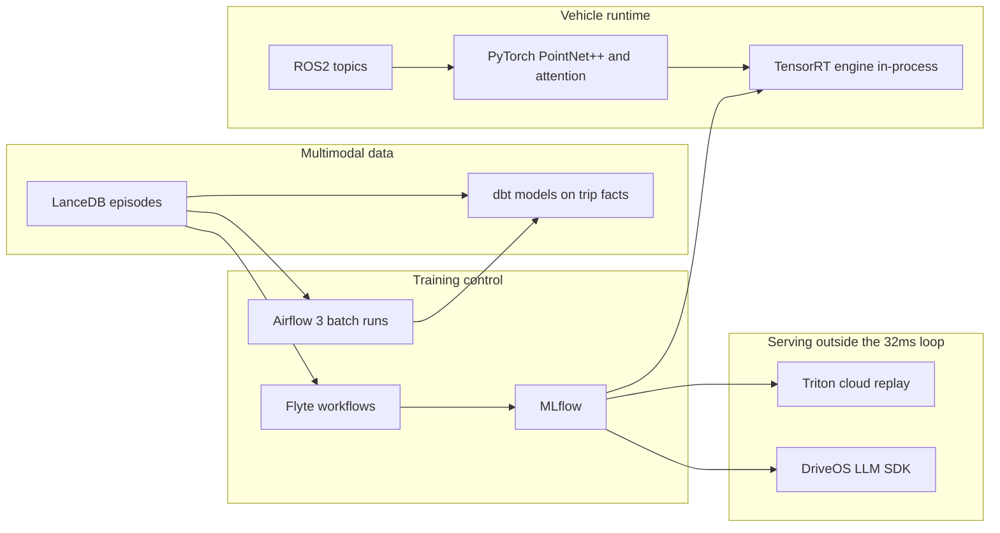
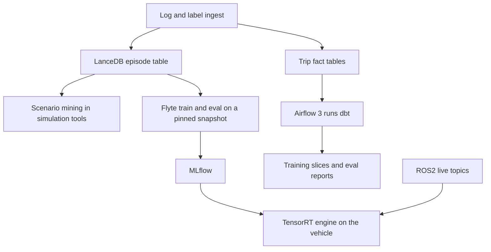

# EV Autonomous Trucking Perception System - Architecture

## System Overview

The EV Autonomous Trucking Perception System is the production perception stack for autonomous electric trucks. The vehicle runtime holds a 32 ms end-to-end budget, against an 85 ms NVIDIA reference, by running the full PointNet++ and multimodal fusion in process. Neural Engine covers Apple Silicon development hosts. TensorRT covers the vehicle GPU. TensorRT-LLM serves the language plane outside that fusion slice.

The production data path is a closed loop. ROS 2 carries cameras, LiDAR, radar, IMU, and GPS with per-stream QoS, acquisition timestamps, and `tf2` frames. NVIDIA Isaac Sim publishes the same topics through its ROS 2 bridge so the perception nodes do not change between simulation, replay, and the truck. Full PointNet++ (512 / 128 / global set abstraction) encodes the cloud. Attention fuses the aligned modalities, including a mask when a sensor is missing. TensorRT executes the perception engine. The ASIL-D runtime checks latency, sensor health, and fault response before a result is allowed downstream. Fleet logs and failed scenarios return to Isaac Sim and to training.

Two planes stay separate. The vehicle plane is PyTorch modules on the ROS2 bus, inside the latency budget. The offline plane is where orchestration, experiment tracking, multimodal storage, and cloud model serving live. Airflow, Flyte, dbt, LanceDB, Triton, and any Qwen-class language model sit on the offline plane, or in a separate on-vehicle language process. They do not run inside the fusion forward pass.

## System Architecture Diagram



## Data Flow Architecture

### 1. Sensor Data Collection Flow



### 2. Multi-modal Fusion Flow



### 3. Perception Processing Flow



### 4. Safety Validation Flow



### 5. Complete System Flow



## Architecture Components

### 1. Core Perception Stack

#### PointNet++ Implementation

The production encoder in `src/perception/pointnet.py` is the full hierarchy, not a per-point Conv1d stand-in.

| Level | Sampled points | Radius | Neighbors | MLP |
| --- | --- | --- | --- | --- |
| Set abstraction 1 | 512 | 0.2 | 32 | 64, 64, 128 |
| Set abstraction 2 | 128 | 0.4 | 64 | 128, 128, 256 |
| Set abstraction 3 | global | — | all remaining | 256, 512, 1024 |

Each level uses farthest-point sampling, ball query, relative XYZ, a shared MLP, and max pooling. The 1024-d global feature feeds a BatchNorm classification head with 20 classes. Downstream detection and segmentation read the multi-scale maps from `extract_features`.

- **Neural Engine**: mixed precision and TorchScript on Apple Silicon development hosts
- **TensorRT**: the vehicle GPU engine built from this same module
- **Kernel fusion**: fewer launches on the sampled groups
- **Sample efficiency**: 3× fewer labeled samples than voxel methods

#### Feature Extraction
- **Multi-scale Feature Aggregation**: Combines features from different abstraction levels
- **Feature Enhancement**: Neural network-based feature enhancement
- **Real-time Processing**: Optimized for 32ms latency target
- **Caching**: Intelligent feature caching for improved performance

### 2. Multi-modal Sensor Fusion

#### Sensor Configuration
- **4× LiDARs**: 128-line LiDAR sensors with 100m range
- **8× Cameras**: 8MP spectral cameras with 30 FPS
- **6× Radars**: mmWave radars with 200m range

#### Sensor Attention
- **Hot path**: `nn.MultiheadAttention` in `src/fusion/llm_attention.py`, default embedding size 512, eight heads. Sensor features are projected into that shared space. A learned context embedding can bias the weights. The forward pass does not load or run a language model.
- **Config name**: `FusionConfig.llm_attention.model_name` is set to `qwen-7b`. That string is not instantiated. The module keeps a placeholder context tensor where a future language-model embedding could be written.
- **Why Qwen stays off this path**: a 7B model does not fit the 8ms fusion slice of the 32ms budget. If a Qwen-class model is deployed on the vehicle later, it runs as its own process through the DriveOS LLM SDK (ONNX export on x86, TensorRT engine built on DRIVE). Supported checkpoints in that SDK include Qwen2.5 7B Instruct and Qwen2-VL. Cabin, planning-language, and log-summarization calls use that process. Fusion does not call it.
- **Demo notebook**: `EV_Autonomous_Driving_Demo.ipynb` runs the same shape of module on synthetic tensors (LiDAR 1024, camera 2048, radar 512) and plots the 32ms line. It is an in-process demonstration, not a serving or data-pipeline runtime.

#### Temporal Fusion
- **LSTM Networks**: Temporal modeling for sequence data
- **Temporal Attention**: Attention-based temporal fusion
- **Smoothing Filters**: Temporal smoothing for consistency
- **Future Prediction**: Predictive modeling for future states

### 3. Safety Framework (ASIL-D Compliant)

#### ASIL-D Runtime
- **Deterministic Execution**: Guaranteed deterministic behavior
- **Fault Tolerance**: Redundant execution for critical operations
- **Safety Monitoring**: Continuous safety state monitoring
- **Fail-safe Operation**: Automatic safe shutdown on failure

#### WCET Analysis
- **Real-time Analysis**: Worst-case execution time analysis
- **Statistical Models**: Multiple WCET estimation models
- **Bound Violation Detection**: Automatic detection of timing violations
- **Performance Recommendations**: Automated optimization suggestions

#### Fault Injection Testing
- **Random Fault Injection**: Systematic fault injection testing
- **Fault Detection**: ML-based fault detection and classification
- **Resilience Scoring**: System resilience assessment
- **Safety Validation**: Comprehensive safety validation pipeline

### 4. AI Development Tools

#### Simulation Tools
- **LLM-generated Scenarios**: AI-powered edge case generation
- **Synthetic Data Generation**: Automated synthetic data creation
- **Scenario Complexity Analysis**: Intelligent scenario difficulty assessment
- **Performance**: 40% reduction in manual scenario design effort

#### Ticket Triage System
- **Fine-tuned Llama-2**: Automated ticket classification
- **Priority Assignment**: Intelligent priority prediction
- **Category Prediction**: Automatic ticket categorization
- **Performance**: F1=0.92 classification accuracy

#### LLM Integration
- **Natural Language Commands**: Voice/text command interface
- **Code Generation**: AI-powered code generation
- **Automated Summarization**: Intelligent conversation summarization
- **Planning Support**: AI-assisted planning and decision support

### 5. Security Framework

#### Zero-Trust Architecture
- **Continuous Verification**: Always-verify security model
- **Behavioral Analysis**: ML-based behavioral analysis
- **Threat Detection**: Real-time threat detection
- **Access Control**: Granular access control system

#### Security Components
- **Anomaly Detection**: ML-based anomaly detection
- **Access Control**: Role-based access control
- **Behavioral Analysis**: User behavior analysis
- **Threat Detection**: Security threat detection

## Data Flow Architecture

### 1. Sensor Data Collection
```
LiDAR → Point Cloud Processing → Feature Extraction
Camera → Image Processing → Feature Extraction
Radar → Signal Processing → Feature Extraction
```

### 2. Multi-modal Fusion
```
Sensor Features → Multi-head Attention → Temporal Fusion → Fused Features
```

### 3. Perception Processing
```
Fused Features → PointNet++ → Object Detection + Segmentation
```

### 4. Safety Validation
```
Perception Output → ASIL-D Validation → Safety Result
```

### 5. Output Generation
```
Safety Result → Final Output → Downstream Systems
```

## Runtime and Offline Platform

The notebook, `src/perception`, and `src/fusion` are the vehicle-shaped code. Platform tools attach beside them.



| Surface | Role today | Platform attachment |
| --- | --- | --- |
| `EV_Autonomous_Driving_Demo.ipynb` | In-process demo and charts | Stays the interactive entry point. A later revision can load a LanceDB scene instead of synthetic tensors. |
| `src/perception`, `src/fusion` | PyTorch PointNet++ and attention | Export measured weights to TensorRT and call them in-process. |
| `docker/docker-compose.yml` MLflow | Experiment tracking service | Flyte or the existing CI writes runs to `http://localhost:5000`, experiment `ev-perception`. |
| `src/ai_tools`, `src/simulation` | Language commands and synthetic scenarios | LanceDB is the scenario index these tools query. |
| `src/ros2_integration/ros2_interface.py` | Live clouds, images, detections | Remains the real-time bus. Orchestrators and dbt do not subscribe to these topics. |

### Modeling and serving

Perception and fusion stay on PyTorch. The notebook and the `src/` modules are `torch.nn` code, and the 3D detection stack has no TensorFlow graph to serve.

| Option | Decision | Where it runs |
| --- | --- | --- |
| PyTorch | Keep. Train and run perception here. | Notebook and vehicle process |
| TensorRT | Export a measured checkpoint (`torch.export` or TorchScript, then a TensorRT engine) and call it in-process. | Vehicle, inside the 32ms budget |
| TensorFlow, TensorFlow Serving | Out of scope. Nothing in the repo produces a SavedModel. | — |
| TorchServe | Out of scope. An HTTP Python server adds latency, serves one model at a time, and does not meet the ROS2 timing path. | — |
| Triton 26.x | Cloud replay and eval only, once real exported models exist. Ensembles use the TensorRT backend and, for language models on x86, the TensorRT-LLM backend (Triton 26.07 pairs TensorRT 10.14 with TensorRT-LLM 1.2). The PyTorch backend still expects a serialized `model.pt`. | Cloud and x86. Not the DRIVE runtime: Triton has not been validated on DRIVE Orin, and TensorRT-LLM has no DRIVE release. |
| DriveOS LLM SDK | Only when a real language or vision-language model is placed on the vehicle. | Separate DRIVE process, off the fusion budget |

### Orchestration

Airflow 3 (April 2025; Airflow 2 reached end of life in April 2026) schedules batch work: log ingest, labeling jobs, dbt runs, and nightly metrics. Asset-aware and event-driven scheduling fits “a log arrived, then evaluate.” DAG authors are engineers. Operators trigger, backfill, and read failures from the UI. A sub-frame control loop is the wrong shape for Airflow.

Flyte is the training orchestrator. Tasks are typed Python functions with cached, versioned outputs, and each step can request its own GPU. Workflows register immutably, which is what reproducing an MLflow run from a pinned dataset requires. Production Flyte is a Kubernetes control plane, so it is an engineering platform, not a no-code builder for the notebook audience.

Neither orchestrator is imported by the notebook. People who are not writing pipelines keep using the notebook and `src/simulation/run_sim.py`. Engineers publish parameterized runs of those entry points.

### Multimodal data and agents

The running system is multi-modal (LiDAR, camera, radar) and single-process. Perception, fusion, safety, and `src/ai_tools/llm_integration.py` are libraries. They are not independent agents. ROS2 is the live message bus when the interface is enabled.

LanceDB is the store for episodes once frames are recorded. One versioned table holds blobs (images, point clouds), embeddings, scenario text, and scalar labels, with vector search, full-text search, and SQL filters on that same snapshot. Simulation and, later, specialist tools query it to mine rare scenes. Embedded mode needs no extra server, so a developer can open it next to the notebook. Training reads a pinned snapshot rather than a side copy of the files. LanceDB is not on the 32ms path, and the notebook’s `torch.randn` tensors are not episodes until an ingest job writes them.

dbt builds the tabular side only: detections, interventions, latency, attention logs, label joins, and manifests that point at a Lance snapshot. A local DuckDB project is enough to start. dbt does not store point clouds and does not schedule agents or the vehicle.

When specialist tools are split into agents, they share that LanceDB memory. One agent searches episodes, another writes a scenario or a ticket summary back. Their metrics land in tables that dbt models. ROS2 still carries the live sensor stream. The fusion forward pass stays a single PyTorch call.



## Performance Characteristics

### Latency Targets
- **End-to-end Latency**: 32ms (vs. 85ms NVIDIA reference)
- **PointNet++ Processing**: 15ms
- **Multi-modal Fusion**: 8ms
- **Safety Validation**: 5ms
- **Output Generation**: 4ms

### Throughput Optimization
- **In-process TensorRT**: Perception and fusion engines run inside the vehicle process. This is the path that can move the 32ms target.
- **TensorRT-LLM**: Cloud and x86 language-model serving through Triton. It is not part of the fusion timing budget.
- **Neural Engine Optimization**: Hardware-accelerated PointNet++ on Apple Silicon development hosts
- **Kernel Fusion**: Reduced computational overhead
- **Memory Optimization**: Efficient memory usage patterns

### Training Efficiency
- **Labeled Samples**: 3× fewer samples vs. voxel methods
- **Synthetic Data**: 40% reduction in manual effort
- **Automated Testing**: 85% code coverage
- **CI/CD Integration**: Automated deployment pipeline

## Deployment Architecture

### Containerization
- **Docker**: Containerized deployment of the perception process
- **Kubernetes**: Scaling for cloud replay and for Flyte’s data plane. The vehicle binary does not wait on the cluster scheduler.
- **AWS ECS**: Cloud deployment of training and replay services
- **Auto-scaling**: Dynamic resource allocation for offline jobs

### Offline services

MLflow is the only one of these already declared, in `docker/docker-compose.yml`. The others are the selected platform, not running services yet.

- **MLflow**: Experiment tracking at `http://localhost:5000`, experiment `ev-perception`
- **Flyte**: Versioned GPU training and evaluation workflows that log to MLflow
- **Airflow 3**: Batch schedules for ingest, labeling, and dbt
- **LanceDB**: Embedded or object-storage episode tables for scenarios and training snapshots
- **dbt**: SQL models on DuckDB locally, or on the warehouse once trip facts exist
- **Triton**: Cloud ensemble for replay. Vehicle language models, when added, use the DriveOS LLM SDK instead

### Monitoring and Observability
- **Prometheus**: Metrics collection
- **Grafana**: Visualization and dashboards
- **MLflow**: Experiment tracking
- **Health Checks**: Automated health monitoring

### Security
- **Zero-Trust**: Always-verify security model
- **Encryption**: End-to-end encryption
- **Access Control**: Role-based access control
- **Audit Logging**: Comprehensive audit trails

## Scalability and Reliability

### Horizontal Scaling
- **Microservices**: Modular architecture
- **Load Balancing**: Traffic distribution
- **Auto-scaling**: Dynamic resource allocation
- **Fault Tolerance**: Graceful degradation

### Vertical Scaling
- **GPU Acceleration**: CUDA optimization
- **Neural Engine**: Hardware acceleration
- **Memory Optimization**: Efficient memory usage
- **CPU Optimization**: Multi-core processing

### Reliability Features
- **ASIL-D Compliance**: Automotive safety standards
- **Fault Tolerance**: Redundant systems
- **Error Recovery**: Automatic error recovery
- **Monitoring**: Continuous system monitoring

## Future Enhancements

### Planned Features
- **ROS2 coverage**: The interface in `src/ros2_integration/ros2_interface.py` already publishes clouds, images, and detections. Remaining work is fleet-wide topic coverage, not a new bus.
- **LanceDB ingest**: Write real episodes from logs and from `src/simulation`, then let the demo and the simulation tools query them.
- **Flyte training workflows**: Register PointNet++ training against a pinned Lance snapshot and the existing MLflow URI.
- **dbt metrics project**: Model detections, interventions, and latency after those facts exist as tables. Airflow 3 runs the project.
- **Triton replay ensemble**: Serve exported perception models for cloud eval. Keep this off the vehicle.
- **DriveOS language process**: Add a Qwen-class model only as a separate DRIVE process, fed by retrieved episodes, not by the fusion module.
- **Fleet learning**: Distributed learning across the fleet, with training sets cut from Lance snapshots.
- **Advanced Security**: Enhanced security features

### Performance Improvements
- **Measured TensorRT export**: Time the real PointNet++ and attention weights, then replace the in-process PyTorch call on the vehicle.
- **Hardware Acceleration**: Neural Engine on development hosts, TensorRT on the vehicle GPU
- **Algorithm Improvements**: Advanced algorithms
- **System Integration**: Wire ingest to LanceDB without touching the ROS2 callback deadline

## Conclusion

The vehicle stack is a PyTorch perception and fusion pipeline on ROS2, with an ASIL-D safety wrapper and a 32ms latency target. Language models, workflow schedulers, and analytical stores support that pipeline from outside the timing loop.

Flyte and MLflow own training reproducibility. Airflow 3 and dbt own batch transforms of trip facts. LanceDB owns multimodal episodes and is the memory later agents share. Triton serves cloud replay. A DriveOS language process is the only approved place for a Qwen-class model on the vehicle. The demo notebook remains the way to run one forward pass and inspect it.
